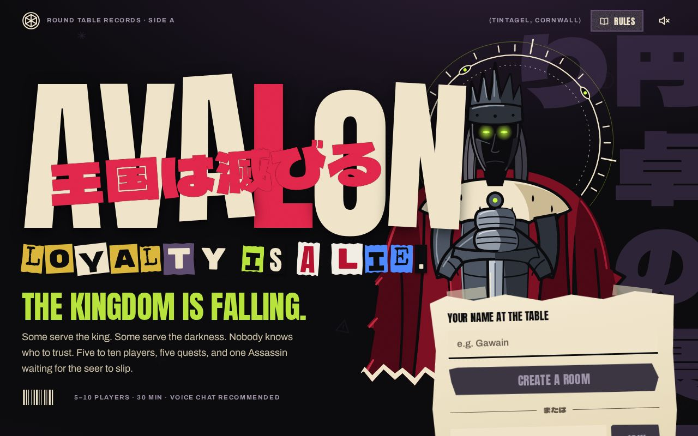

<div align="center">



# Avalon

**The Resistance: Avalon in the browser, for 5 to 10 players on their own phones.**

[Play it](https://avalon.futile.studio) · [Futile Studio](https://futile.studio)

    

</div>

> **Futile Studio** · Games, social deduction · Live since Nov 2026

## Overview

A real-time version of Avalon. Good tries to finish three quests. Evil tries to sink three, or to get five teams rejected in a row. If good wins, the Assassin still gets one guess at Merlin.

Everyone plays on their own device, so the hidden information stays hidden. There is no shared TV screen. It works at one table or over a voice call.

## How to play

1. One person types a name and creates a room. They get a 5-letter code and a link (`/r/CODE`) to share.
2. Everyone else joins with the code or the link and marks themselves ready.
3. The host picks the special roles: a "Basic game" preset (Merlin and Assassin), the recommended set for the player count, or a custom mix. Invalid mixes are blocked (for example Morgana without Percival).
4. Each player sees their role card privately, plus whoever their role lets them see.
5. Rounds go: the leader proposes a team, everyone votes at once (a tie rejects), then the team plays secret SUCCESS or FAIL cards. Good can only play SUCCESS. Quest 4 needs two fails at 7+ players.
6. At the end everyone's role is revealed, and the host can take the table back to the lobby for a rematch.

There is a rules page in the app with the quest sizes and every role.

### Roles

| Good | Evil |
| --- | --- |
| Merlin (sees evil, except Mordred) | Assassin (one shot at Merlin at the end) |
| Percival (sees Merlin and Morgana, not which is which) | Morgana (looks like Merlin to Percival) |
| Loyal Servant | Mordred (hidden from Merlin) |
| | Oberon (evil, but does not know the others and they do not know him) |
| | Minion of Mordred |

## Features

- Rooms survive a server restart. They are saved to a JSON file and cleaned up after 6 idle hours.
- Refreshing or reconnecting puts you back in the same seat with the same role (tied to a token in your browser).
- If the host drops mid-game, the crown passes to the next connected player after a grace period.
- The server only ever sends each player what they are allowed to know. Votes stay secret until everyone has voted, and quest cards only show the fail count.
- All sound is synthesised with WebAudio, and it stays off until a player turns it on.
- Respects reduced motion settings.

## Stack

- React 19, Vite 6, Tailwind 4, Motion, Zustand
- Node 20, Express, Socket.IO 4, run with tsx
- Vitest for the game engine and server tests
- Game rules live in `shared/` and are used by both server and client

## Running it locally

```sh
npm install
npm run dev
```

This starts the Socket.IO server on port 3001 and Vite, which proxies `/socket.io` to it. Open the URL Vite prints.

Other scripts:

```sh
npm test           # vitest (engine + server)
npm run typecheck
npm run build      # typecheck + vite build into dist/
npm start          # production: serves dist/ and the socket server on PORT
```

`scripts/e2e.mjs` and `scripts/visual.mjs` are Playwright playthroughs I use against a running build. They expect a local headless Chromium at a fixed path, so treat them as personal tooling.

## Configuration

| Variable | Default | Purpose |
| --- | --- | --- |
| `PORT` | `3001` | HTTP and socket port |
| `DATA_DIR` | `data` | Where `rooms.json` is saved |
| `HOST_GRACE_MS` | `20000` | How long a disconnected player keeps their seat before being removed (lobby) or losing host (in game) |
| `CORS_ORIGIN` | off | Allowed socket origin, only needed if the client is served from somewhere else |

## Deployment

A GitHub Action builds the Docker image on every push to `main` and pushes it to `ghcr.io/mayurjivani/avalon`. The image runs the tests during the build, listens on 4441 and keeps state in `/data`. `deploy/compose.yaml` runs it read-only with a 256 MB memory limit, and `deploy/avalon.caddy` puts it behind Caddy with response buffering turned off so votes and reveals reach everyone at once.

## Project structure

```
shared/   rules, game engine, socket protocol types
server/   Express + Socket.IO server, rooms and persistence
src/      React client (screens, UI bits, role art, sound)
tests/    engine and server tests
deploy/   compose file, Caddy block, deploy script
```

## Credits

Based on the board game The Resistance: Avalon by Don Eskridge. This is an unofficial fan version.

## Licence

No licence file yet, all rights reserved.

---

<p align="center"><sub>Built by <a href="https://github.com/MayurJivani">Mayur Jivani</a> at <a href="https://futile.studio">Futile Studio</a>. Everything is futile. Do it anyway.</sub></p>
